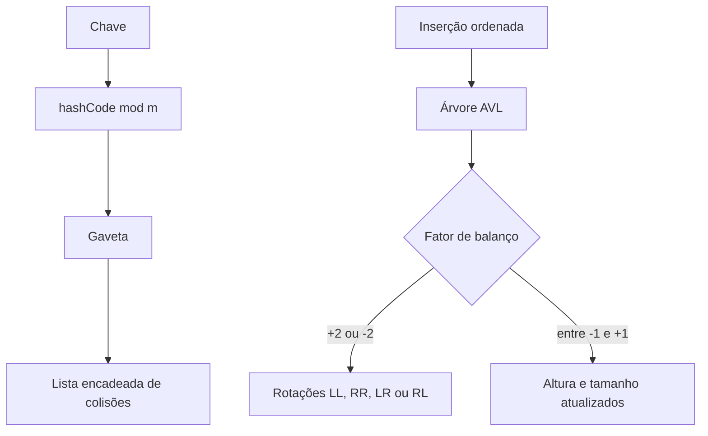

# Estruturas de Dados: AVL e Tabela Hash

[](https://openjdk.org/)
[](#estruturas-implementadas)
[](https://github.com/edusotho32/tpa-algorithms-avl-hash/actions/workflows/ci.yml)

Reimplementação didática, sem dependências externas, de uma árvore AVL e de uma tabela hash com método da divisão e encadeamento separado. O objetivo é tornar observáveis os invariantes, as colisões e o custo das operações estudadas em Técnicas de Programação Avançada no IFES.

## Problema de engenharia

Busca linear deixa de escalar quando o conjunto cresce. A tabela hash privilegia acesso médio constante sem preservar ordem; a AVL preserva ordem e mantém altura logarítmica por meio de rotações. O repositório permite comparar as garantias em código executável e testado.



## Estruturas implementadas

| Estrutura | Operação | Custo esperado |
|---|---|---|
| Hash encadeada | inserir, buscar, remover | `O(1)` médio; `O(n)` no pior caso |
| AVL | inserir, buscar | `O(log n)` |
| AVL | piso, teto, posto | `O(log n)` |
| AVL | percurso em ordem | `O(n)` |

A hash redimensiona ao ultrapassar fator de carga `0,75`. A AVL mantém altura e tamanho de subárvore em cada nó, permitindo calcular `rank` sem percorrer toda a árvore.

## Executar localmente

Requer JDK 8 ou superior disponível no `PATH`.

```powershell
.\scripts\run.ps1
```

## Testes automatizados

```powershell
.\scripts\test.ps1
```

O teste é autocontido e falha com código de saída diferente de zero. Ele verifica colisões, atualização, remoção, redimensionamento, preservação de dados, as quatro rotações AVL, percurso ordenado, piso, teto, posto e invariantes de balanceamento.

## Estrutura

```text
src/main/java/.../DivisionHashTable.java  hash por divisão e encadeamento
src/main/java/.../AvlTree.java            árvore balanceada e operações ordenadas
src/main/java/.../Demo.java               execução curta
src/test/java/.../AlgorithmTest.java      suíte sem dependências externas
scripts/                                  compilação e execução reproduzíveis
```

## Limite de atribuição

Esta é uma reimplementação de portfólio. Os gabaritos e fontes didáticas de terceiros encontrados na pasta original não foram publicados. Leia [PROVENANCE.md](PROVENANCE.md) antes de citar o trabalho em entrevista.
